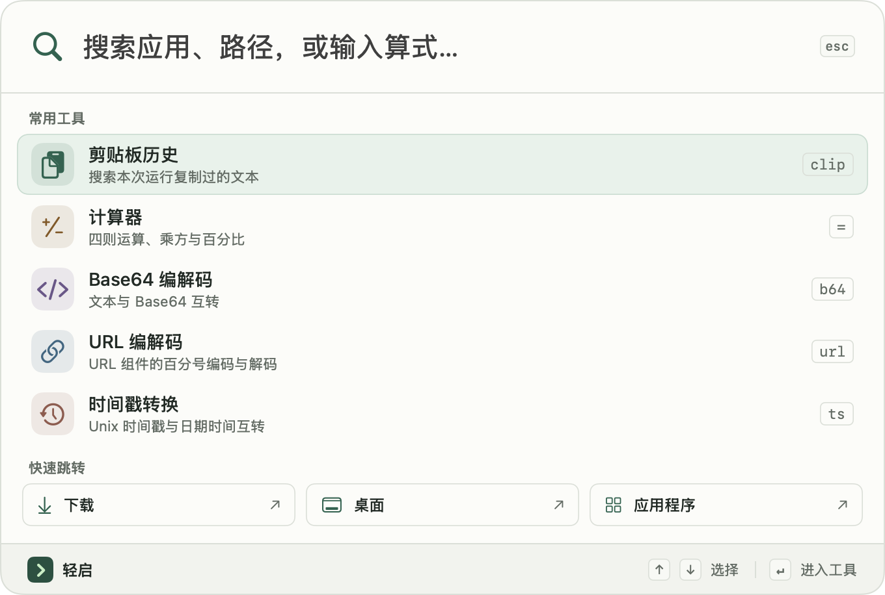

# 轻启 · Qingqi

一个用 Swift、AppKit 和 SwiftUI 写的 macOS 菜单栏启动器。按 **⌥ 空格**，可以打开应用和路径、找回刚复制的文字，或直接输入算式。用 ↑ ↓ 选择，回车打开目标或复制结果。



## 从源码运行

目标系统为 macOS 13 或更高版本。构建需要 Xcode Command Line Tools，可用 `xcode-select --install` 安装。

```sh
git clone https://github.com/exjoshua/qingqi.git
cd qingqi
zsh ./build.sh
open ./build/轻启.app
```

脚本会为当前 Mac 的处理器架构编译并在本地签名。点击菜单栏的「跃点」图标也可以呼出面板，右键查看实际注册的快捷键或退出轻启。

## 输入示例

| 功能 | 输入 | 结果 |
| --- | --- | --- |
| 快速跳转 | `Safari`、`~/Downloads` 或网址 | 回车打开应用、文件、文件夹或网页 |
| 剪贴板 | `clip 关键词` | 搜索本次运行复制的文本，回车重新复制 |
| 计算器 | `(48 + 12) × 1.25` | `75` |
| Base64 | `b64 你好`、`b64d 5L2g5aW9` | UTF-8 文本与 Base64 双向转换 |
| URL 编解码 | `urlencode a b`、`urldecode a%20b` | 按 URL 组件编码或解码，空格编码为 `%20` |
| 时间戳 | `ts now`、`ts 1700000000s`、`ts 2023-11-14T22:13:20Z` | 在 Unix 秒、毫秒、本地时间和 UTC 之间转换 |

剪贴板历史保存在内存中，退出即清空。轻启每 0.5 秒检查一次系统剪贴板，跳过来源应用标记为保密、临时或自动生成的内容。

## 许可证

[MIT](LICENSE)
